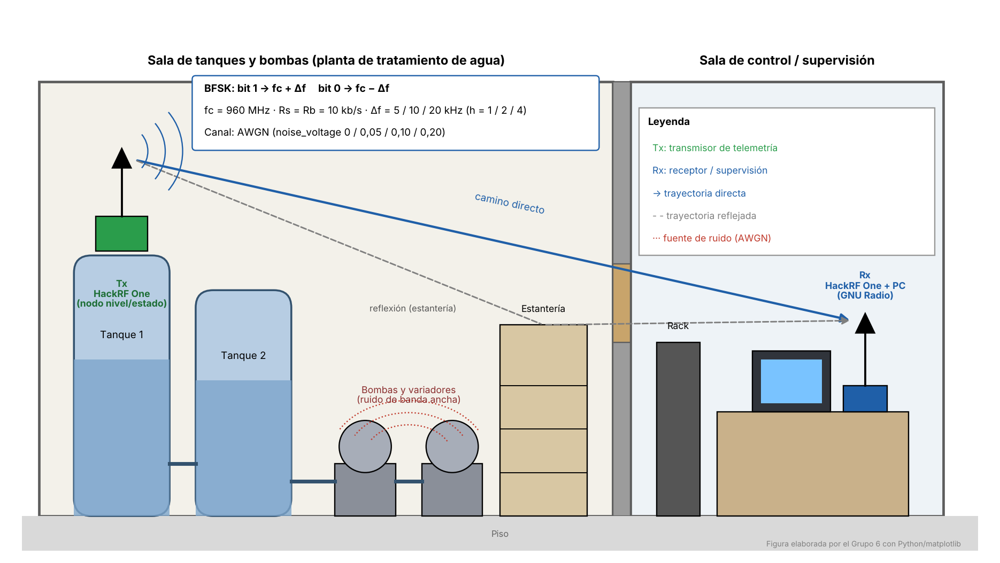
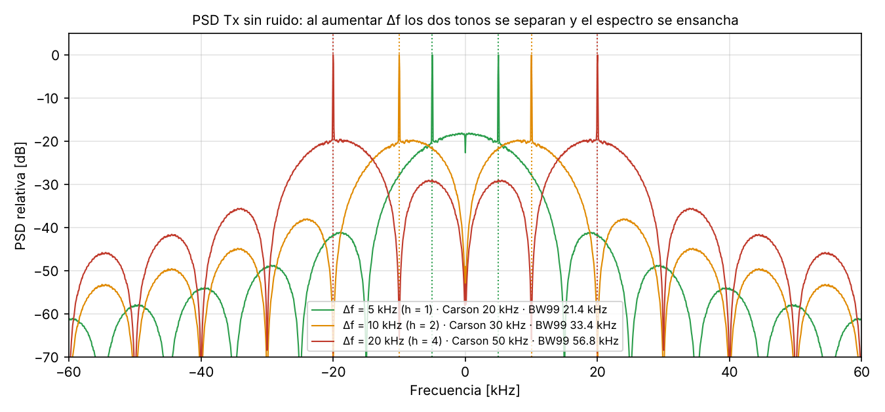
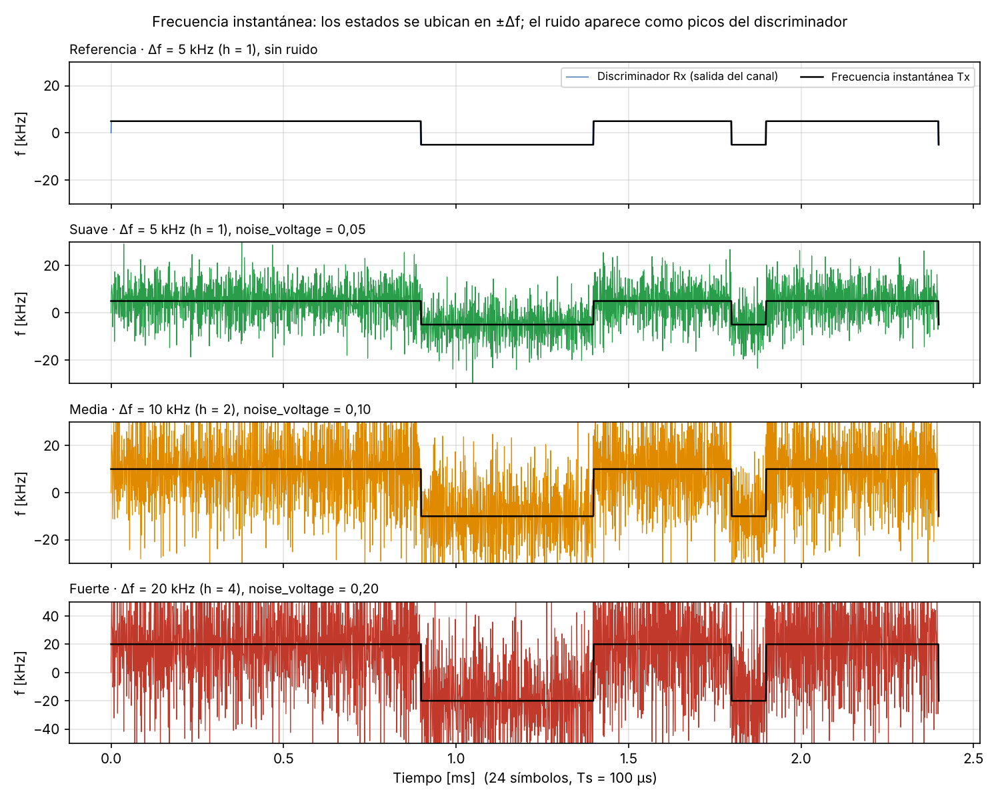
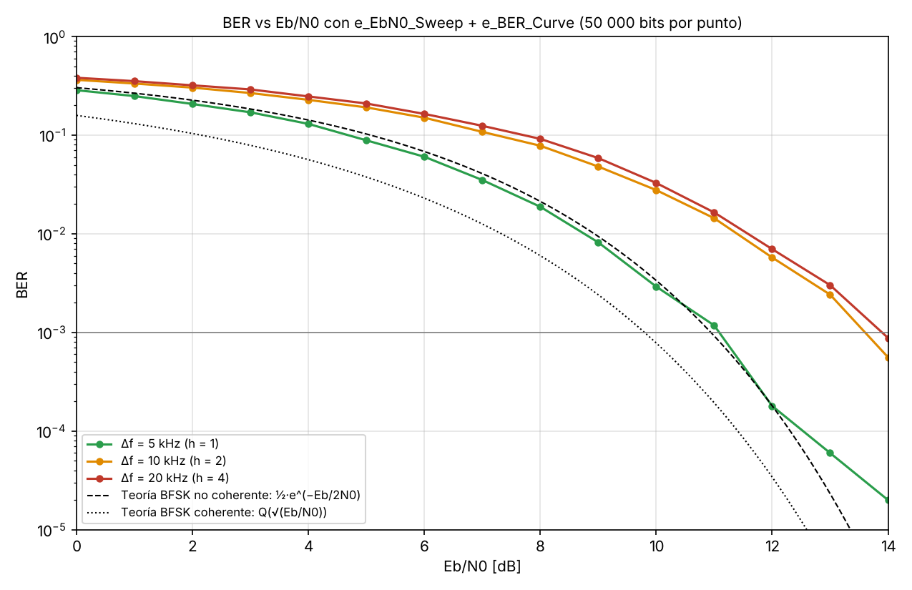

# Telemetría binaria mediante BFSK (Comunicaciones II, Grupo 6)

**Escenario:** S5 · Telemetría binaria mediante FSK
**Integrantes:
** Juan Pablo Moreno Peña · 
Juan David Ruiz Higuera
**Curso:** Comunicaciones II, Universidad Industrial de Santander, 2026-2
**Video de socialización:** https://youtu.be/89CpjFcQKe8



## Resumen
Un nodo de telemetría en una planta de tratamiento de agua envía bits de estado hacia la sala de control usando BFSK: el bit 1 va en fc + Δf y el bit 0 en fc − Δf. Con la decisión técnica corregida (Rs = Rb = 10 kb/s, SPS = 100, fs = 1 MS/s, GRC base `Modulacion_FSK_AWGN.grc`) se estudió cómo la desviación Δf (5, 10 y 20 kHz; h = 1, 2 y 4) cambia la separación de los estados y el ancho de banda, siguiendo las cuatro pruebas del selector guiado. Como extensión se diseñó un receptor propio (filtro de canal, discriminador, integrador, Gardner y umbral), se prepararon los flujogramas para HackRF One y se midió la curva BER vs Eb/N0. El BW99 pasa de 21,4 a 56,8 kHz al subir Δf de 5 a 20 kHz, y con un filtro ajustado a Carson el Δf menor necesita 11,1 dB para BER = 10⁻³, frente a 13,9 dB con 20 kHz.

## Corrección de la decisión técnica
La ficha original (`docs/decision_Grupo6.json`) fue calificada «TODAVÍA NO VIABLE» por dos bloqueos. La ficha corregida está en `docs/ficha_decision_tecnica_corregida.pdf` y `docs/decision_Grupo6_corregida.json`.

| Campo | Original | Corregido | Motivo |
|---|---|---|---|
| Parámetros | A · Rs = 32 kBd, SPS = 8, fs = 256 kS/s | C · Rs = 10 kBd, SPS = 100, fs = 1 MS/s | El GRC base trabaja a 1 MS/s con sps = 100; S5 exige mantener Rs fija |
| Perturbación | AWGN únicamente | Variar Δf | En S5 el fenómeno es la desviación de frecuencia, no el ruido |
| GRC | Modulacion_FSK.grc | Modulacion_FSK_AWGN.grc | El selector usa la versión con AWGN para comparar ideal vs ruido |

## Parámetros
| Parámetro | Valor |
|---|---|
| Modulación | BFSK de fase continua (2 estados) |
| Rs / Rb | 10 kBd / 10 kb/s (Rb = Rs·log2 2) |
| SPS | 100 |
| fs (samp_rate) | Rs·SPS = 1 MS/s |
| Δf (variable del experimento) | 5 / 10 / 20 kHz → h = 1 / 2 / 4 |
| BW Carson 2(Δf + Rb/2) | 20 / 30 / 50 kHz |
| Ruido por prueba | noise_voltage 0 / 0,05 / 0,10 / 0,20 |
| Hardware | HackRF One, fc = 960 MHz, radio_rate = 2 MS/s (resampler 2/1), lo_off = 200 kHz |

## Archivos GRC y cómo ejecutarlos
Abrir en GNU Radio y pulsar *Run* (F6).
- `grc/archivos_modificados/G6_Modulacion_FSK_AWGN_S5.grc`: **flujograma principal de las pruebas.** Es una copia del GRC base en la que solo cambian `fsk_deviation` y `noise_voltage` (más variables de cálculo h, Carson y Eb/N0). Ajustar los dos deslizadores según la tabla de pruebas.
- `G6_BFSK_TxRx_Simulacion.grc`: extensión con el receptor del grupo (recupera los bits y muestra el ojo).
- `G6_BFSK_HackRF_Tx.grc` / `G6_BFSK_HackRF_Rx.grc`: enlace con dos HackRF One en dos computadores. Requiere gr-osmosdr. En el Rx, ajustar `rx_ppm` hasta que el offset estimado quede cerca de 0 Hz.
- `G6_BFSK_HackRF_Rx_BER.grc`: receptor con `e_EbN0_Sweep`, `e_BER_Curve` y escritura de `curva_BER.csv` (Guía 4).
- `G6_BFSK_BER_Simulacion.grc`: la misma medición con el SDR reemplazado por una conexión directa.


## Tabla de pruebas
| Prueba | Δf | noise_voltage | h | BW Carson | BW99 medido | Eb/N0 | Errores (receptor propio) |
|---|---|---|---|---|---|---|---|
| Referencia | 5 kHz | 0 | 1 | 20 kHz | 21,4 kHz | ∞ | 0 / 19 477 |
| Suave | 5 kHz | 0,05 | 1 | 20 kHz | 21,4 kHz | 46,0 dB | 0 / 19 477 |
| Media | 10 kHz | 0,10 | 2 | 30 kHz | 33,4 kHz | 40,0 dB | 0 / 19 477 |
| Fuerte | 20 kHz | 0,20 | 4 | 50 kHz | 56,8 kHz | 34,0 dB | 0 / 19 477 |

Extensión, Eb/N0 para BER = 10⁻³: 11,1 dB (Δf = 5 kHz), 13,6 dB (10 kHz) y 13,9 dB (20 kHz). Los datos completos están en `data/tablas_de_pruebas/`.





## Conclusión principal
La hipótesis H1 se cumple: al aumentar Δf la separación entre estados (2Δf) y el ancho de banda crecen casi linealmente, en línea con Carson. El ruido aparece en la frecuencia instantánea como picos del discriminador, y filtrar al ancho de Carson antes de discriminar los elimina. Con ese filtro, un Δf mayor deja pasar más ruido y empeora la BER, así que para la telemetría del escenario se recomienda h = 1 (Δf = 5 kHz).

## Estructura
```
grc/            archivos originales del curso y flujogramas modificados
figures/        escenario, PSD, FSK (frecuencia instantánea, I/Q, ojo, capturas de GNU Radio), diagramas técnicos, laboratorio
data/           curva_BER.csv y tablas de pruebas
docs/           informe final, fichas de decisión técnica (original y corregida), bitácora
referencias/    fuentes y enlaces
scripts/        scripts de simulación y figuras (Python + GNU Radio)
```

## Uso de IA
El grupo declara que estos archivos son producto de nuestro propio trabajo. Las ideas y resultados de otros autores se citan en formato IEEE en la sección de referencias del informe. Se aclara el uso de herramientas de inteligencia artificial (Claude y Gemini) para la consulta de información relacionada con el tema, elaboración de la imagen del escenario, revisión de normativa y para la revisión ortográfica del texto.
